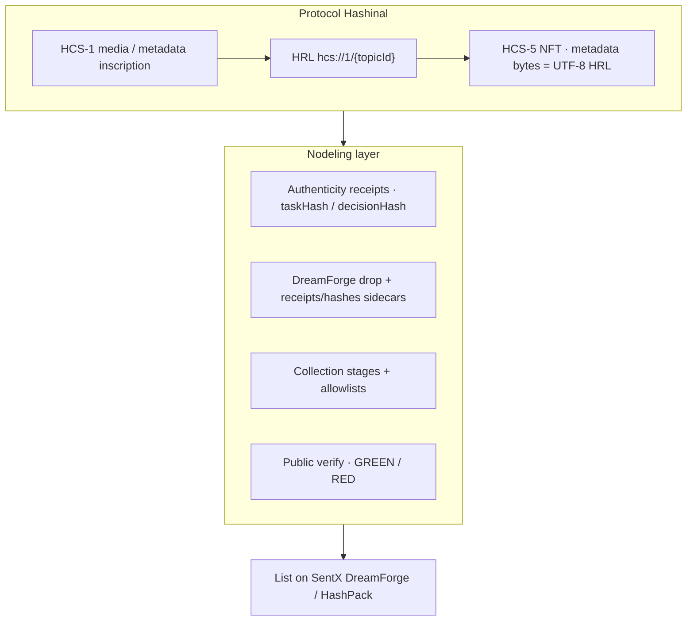

# Nodeling Hashinal (canonical)

**Hashinal** is the protocol. **Nodeling** is Vera Labs’ product layer on top of it.

## Layers

Or as a list:

1. **Protocol Hashinal** — HCS-5 NFT; media/metadata via HCS-1; NFT metadata bytes = UTF-8 of `hcs://1/<topicId>`.
2. **Nodeling authenticity** — per-edition receipts (`taskHash` / `decisionHash`); offline GREEN/RED.
3. **DreamForge packaging** — drop folder validates like sentx-drop; `*-nodeling-receipts.json` / `*-nodeling-hashes.json` sit **beside** the folder (not inside the upload set).
4. **Stages / allowlists** — whitelist rounds vs public; dry-run mint gate; multi-collection holder snapshots.
5. **Public verify** — paste receipt / package / HRL; recompute hashes; no trust-me screenshots.
6. **List elsewhere** — SentX DreamForge / HashPack. Nodeling is **not** a marketplace competitor.

## Mint flow (dry-run default)

Ordered plan from `planHashinalMint`:

1. **HCS-1** — stub inscription → topic + HRL  
2. **TokenCreate** — HTS NFT create payload (max supply, name, symbol)  
3. **TokenMint** — metadata = UTF-8 bytes of `hcs://1/<topicId>`  
4. *(optional)* **Registry anchor** — stub `decisionHash` write

Live Hedera txs and SentX writes stay **opt-in / env-gated**. Default is dry-run; no keys in the browser.

## Why it’s cool

- **Prove authenticity offline** — GREEN clean package; RED on tamper, bad edition, forged allowlist.
- **Real Hashinal HRL pattern** — not random IPFS metadata; resolvable `hcs://1/<topic>`.
- **DreamForge-ready without competing with SentX** — prep + receipts here; list there.
- **Stages / allowlists for drop ops** — not just a mint button.
- **Forkable Scaffold-HBAR offline demo** — `npm run demo` needs no Hedera account.

## Scope

- **NFT-first.** Music drops are Phase 2 (deferred).
- Spec module: `@nodeling/core` → `describeNodelingHashinal()`.
- UI: Next.js `/start` (utilize paths) · `/about`.
- How others use it: [for-others.md](./for-others.md).
- Longer walkthrough: [how-it-works.md](./how-it-works.md).
